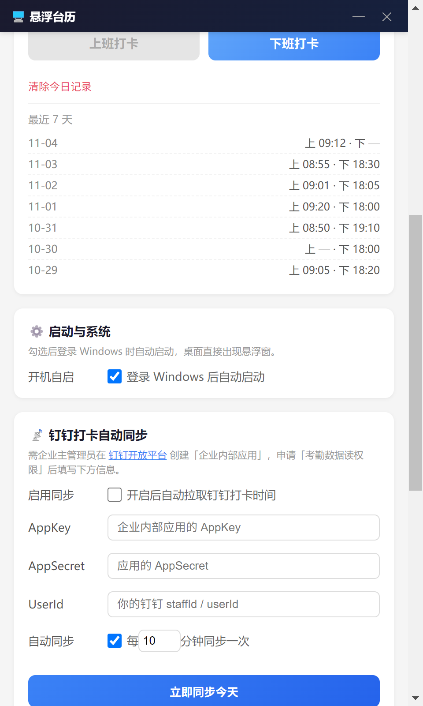

# 悬浮台历 (Float Calendar)

桌面悬浮小窗口，显示时间、自定义文字、打卡状态。点击展开完整台历 + 设置面板。

> 上班打卡后自动按弹性工时推算下班时间，并实时倒计时——**08:31 打卡 → 18:01 就能下班**。

## 截图

| 悬浮窗 | 主窗口 |
|:---:|:---:|
|  |  |



## 功能

- **悬浮小窗**：始终置顶，半透明，可拖动到桌面任意位置
- **时间显示**：实时时钟（可选秒数），日期+星期
- **真实打卡记录**：悬浮窗显示**实际打卡时间**（不再是计划时间），迟到自动标橙色
- **手动打卡**：主窗口/托盘一键记录上班/下班（当前时间），按天归档、近 7 天可查
- **打卡时间可编辑**：主窗口「今日打卡」的时间框可直接点击修改（或清空）
- **弹性工时自动推算**：按上班打卡时间 + 工作时长自动算出应下班时间，并**毫秒级实时倒计时**（`时:分:秒.毫秒`）
- **钉钉自动同步**：配置企业内部应用凭据后，定时拉取钉钉考勤接口的真实打卡时间（该配置区默认折叠，点标题展开，右侧徽标显示当前状态）
- **自定义文字**：显示一句你想看的话
- **点击展开**：点击悬浮窗弹出主窗口，包含月历 + 全部设置
- **颜色/透明度自定义**：背景色、文字色、强调色、窗口透明度
- **系统托盘**：托盘菜单可显示/隐藏悬浮窗、打开主窗口、退出
- **位置记忆**：拖动后的位置自动保存，重启后恢复
- **开机自启**：主窗口或托盘菜单勾选即可，写入当前用户注册表，无需管理员权限
- **单实例**：重复双击不会再开一个悬浮窗，而是把已有主窗口叫到前面

## 运行

```bash
cd float-calendar
npm install
npm start
```

> 如果 npm 下载 Electron 慢，使用镜像：
> ```bash
> ELECTRON_MIRROR=https://npmmirror.com/mirrors/electron/ npm install --registry=https://registry.npmmirror.com
> ```

> **改了 HTML/CSS 后看不到效果？** Electron 不会热重载页面，必须**完全退出应用**（托盘右键 → 退出，或结束所有 `electron.exe` 进程）再启动。应用已内置启动时清缓存 + 加载时间戳参数，正常重启即可生效。

## 打包成 Windows 应用（exe）

```bash
npm install
npm run build
```

产物在 `dist/`：

| 文件 | 说明 |
|---|---|
| `FloatCalendar-Setup-1.0.1.exe` | **安装版（推荐）**：可选择安装目录，自动创建桌面和开始菜单快捷方式 |
| `FloatCalendar-Portable-1.0.1.exe` | **便携版**：单个 exe，免安装，可直接拷到 U 盘 |

首次打包会下载 Electron 和 NSIS 资源，国内建议加镜像：

```bash
ELECTRON_MIRROR=https://npmmirror.com/mirrors/electron/ \
ELECTRON_BUILDER_BINARIES_MIRROR=https://npmmirror.com/mirrors/electron-builder-binaries/ \
npm run build
```

应用图标由 `.preview/gen-icon.js` 生成（`npm run icon`），输出 `assets/icon.png`、`assets/icon.ico`、`assets/tray.png`。

## 体积与内存

打包后 exe 约 **71–77 MB**，运行时约 **180 MB 私有内存**（4 个进程）。

这是 Electron 的固有成本：安装包里内嵌了一整套 Chromium + Node.js 运行时，所以体积下限在
70 MB 左右、运行内存下限在 150 MB 左右。VS Code、Slack、Discord 等同类应用都是这个量级。

已做的优化：

| 优化 | 效果 |
|---|---|
| `app.disableHardwareAcceleration()` | GPU 进程 122 MB → 19 MB，总私有内存 283 MB → 181 MB |
| `compression: "maximum"`（NSIS LZMA） | 安装包 84 MB → 77 MB |
| `electronLanguages: ["zh-CN","en-US"]` | locales 从 50+ 个文件减到 2 个 |
| `spellcheck: false` | renderer 再省几 MB |

代价是软件渲染下 CPU 约占全机 1%（18 核实测）。想省电可以删掉 `main.js` 里的
`app.disableHardwareAcceleration()`，内存回到约 283 MB，合成交给 GPU。

> 任务管理器里看到的 400 MB+ 是各进程 WorkingSet 的**累加**，其中多份共享的 Chromium DLL
> 被重复计入。真实占用要看「专用工作集 / 提交大小」这一列。

## 开机自启

安装版或便携版启动后，在**主窗口「⚙️ 启动与系统」**或**托盘右键菜单**里勾选「开机自启」。

- 写入位置：`HKCU\Software\Microsoft\Windows\CurrentVersion\Run`（当前用户，不需要管理员权限）
- 便携版注册的是**原始 exe 路径**而不是临时解压目录，所以把 exe 挪到别的文件夹后需要重新勾选一次
- 开发模式（`npm start`）下该开关是禁用的——那时路径指向 `electron.exe`，注册了也没有意义

## 数据目录

配置和打卡记录存在 `%APPDATA%\float-calendar\`：

- `config.json`：悬浮窗、弹性工时、钉钉凭据等全部设置
- `records.json`：按天归档的打卡记录

换机器时把这两个文件拷过去即可。

## 使用

1. 启动后悬浮窗出现在桌面右下角
2. **拖动**悬浮窗到任意位置（位置自动保存）
3. **点击**悬浮窗展开主窗口
4. 在主窗口中编辑自定义文字、打卡时间、颜色等
5. 点击「保存设置」即时生效
6. 「今日打卡」区可一键记录上班/下班，或清除重记
7. 有钉钉企业管理员权限时，在「钉钉打卡自动同步」区填写凭据即可自动拉取真实打卡时间

## 弹性工作制

默认规则：**上班弹性 08:30–09:00，工作满 9.5 小时即可下班**，因此下班弹性为 18:00–18:30。

- 08:30 打卡 → 18:00 可下班
- **08:31 打卡 → 18:01 可下班**
- 09:00 打卡 → 18:30 可下班
- 早于 08:30 打卡按 08:30 算（早到不加时长）
- 晚于 09:00 打卡视为迟到，按实际时间顺延（如 09:15 → 18:45）

主窗口「今日打卡」区实时显示「按打卡推算可下班 18:01 · 还有 02:37:12.483」；悬浮窗底部也有一行同样的毫秒倒计时，到点变成「🎉 可以下班了」。
可在「悬浮窗设置 → 弹性工作制」里调整上班弹性区间和工作时长，下班弹性会自动跟着变。取消勾选则回退为固定上下班时间。

## 钉钉打卡自动同步（可选）

钉钉官方考勤接口**只对企业内部应用开放**，个人身份无法直接读取。要自动同步需要：

1. 由企业主管理员登录 [钉钉开放平台](https://open.dingtalk.com/)，创建「企业内部应用」
2. 为该应用申请并开通 **考勤数据读权限**（`qyapi_get_attendance` 相关权限）
3. 拿到应用的 **AppKey / AppSecret**
4. 查出你自己的 **userId**（钉钉 staffId，可在通讯录或管理后台查看）
5. 把以上信息填入主窗口「钉钉打卡自动同步」区（该区默认折叠，点标题展开），勾选「启用同步」并保存

没有管理员权限时，用「今日打卡」按钮手动记录即可，记录的就是真实打卡时间。

同步逻辑：上班取当天**最早**一次 OnDuty，下班取当天**最晚**一次 OffDuty；只填空值，不覆盖手动记录。

## 技术栈

- Electron 33
- 纯 HTML/CSS/JS（无框架依赖）
- 配置持久化到 `userData/config.json`

## 文件结构

```
float-calendar/
├── main.js        # 主进程：窗口创建、IPC、配置管理、托盘、定时同步
├── preload.js     # 预加载脚本：安全的 contextBridge
├── records.js     # 打卡记录存储（按天归档到 records.json，支持手动改时间）
├── dingtalk.js    # 钉钉考勤 API 封装（token + 打卡详情解析）
├── flex.js        # 弹性工时计算（两个页面共用的纯浏览器脚本）
├── float.html     # 悬浮窗页面（时间/日期/自定义文字/真实打卡/下班倒计时）
├── main.html      # 主窗口页面（日历 + 今日打卡 + 钉钉配置 + 弹性设置）
├── assets/        # 应用图标（icon.png / icon.ico / tray.png）
├── package.json   # 含 electron-builder 打包配置
├── docs/          # README 用的截图
└── .preview/
    ├── gen-icon.js      # 生成应用图标（输出到 assets/）
    ├── render-float.js  # 真实渲染悬浮窗并截图（输出 float-render.png）
    ├── render-main.js   # 真实渲染主窗口并截图（输出 main-render*.png）
    └── test-dingtalk.js # 钉钉解析逻辑单测（mock fetch）

## 已知坑

- 悬浮窗**不要**给容器加 CSS `opacity`：Windows 的 `transparent: true` 窗口下，整层半透明会导致
  GPU 合成错乱，出现文字被色块盖住的现象。半透明只作用在背景色（`rgba`）上，文字保持不透明。
- 内容行数较多时窗口高度要给足，并给每行 `flex-shrink: 0` + 固定 `line-height`，否则 flex 会压缩行高造成重叠。
- 打包后调试时注意：如果 shell 里有 `ELECTRON_RUN_AS_NODE=1`，exe 会以纯 Node 模式启动、不加载 app
  （表现为进程在但没窗口）。测试打包产物前先 `unset ELECTRON_RUN_AS_NODE`。
